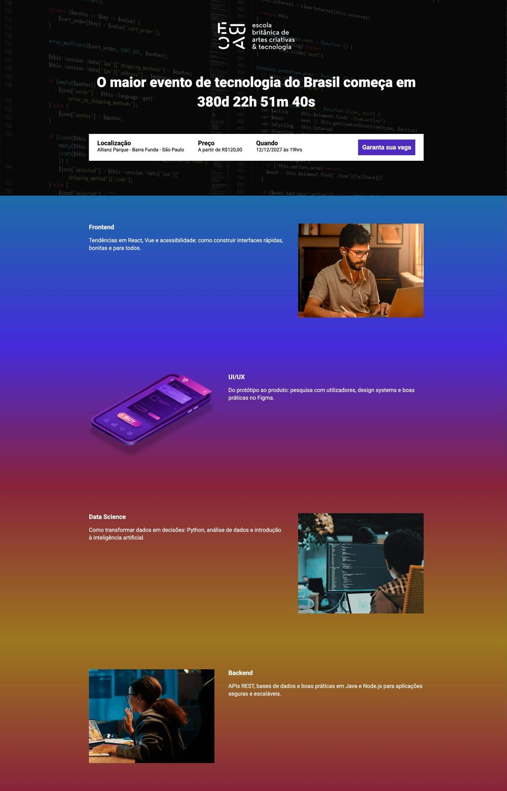
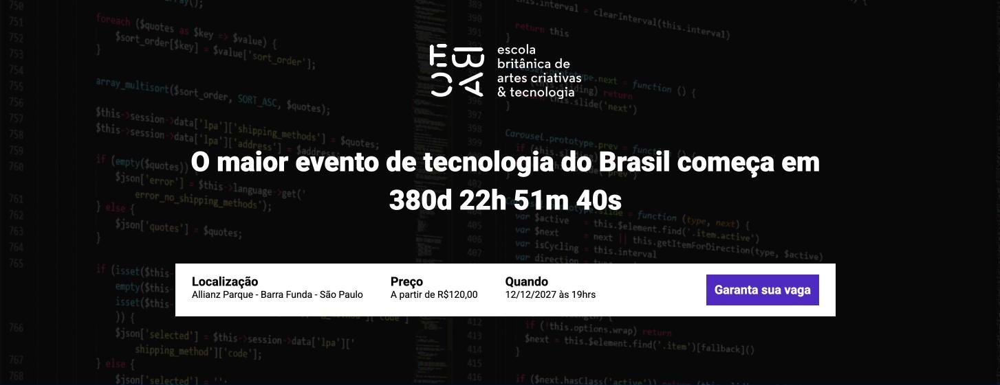

# 🎤 EBAC Tech Talks — landing page de evento

Landing page para um evento de tecnologia, com **contagem regressiva em tempo real** até à data do evento, barra de informações (local, preço e data), botão de inscrição e quatro secções temáticas (Frontend, UI/UX, Data Science e Backend) com animações ao fazer scroll.

> 🎓 **Projeto académico:** trabalho feito no curso da EBAC. O evento é fictício e serve apenas para praticar.

🔗 **Demo:** [ebac-tech-talks-five-eta.vercel.app](https://ebac-tech-talks-five-eta.vercel.app)


---

## 📸 Página completa

<p align="center"></p>

## 🔍 Detalhe: contagem regressiva e barra de informações



## ✨ O que pratiquei

**JavaScript (sem bibliotecas para a lógica)**
- **Contagem regressiva** com `Date` e `setInterval`, que calcula dias, horas, minutos e segundos até ao evento e atualiza a página a cada segundo
- Mensagem automática quando a data do evento passa

**SASS**
- Estilos organizados em **parciais** (`_hero`, `_event`) e **componentes** (`_buttons`, `_infos_bar`)
- **Variáveis** de cores num ficheiro próprio, usadas com o sistema de módulos `@use`
- Nomenclatura **BEM** (`event__details__title`, `event--image-left`, `button--primary`)
- **Gradientes** que fazem a transição de cor entre as secções
- **Media queries** para telemóvel e tablet

**Outros**
- Animações ao fazer scroll com a biblioteca **AOS**
- Build com **Parcel** (compila o SASS e otimiza as imagens com `sharp`)

## 📁 Estrutura

```
src/
├── images/              # Imagens do hero e das secções
├── scripts/main.js      # Contagem regressiva + AOS
├── styles/
│   ├── components/      # _buttons, _infos_bar
│   ├── _hero.scss
│   ├── _event.scss
│   ├── _variables.scss
│   └── main.scss
└── index.html
```

## ▶️ Como executar

```bash
git clone https://github.com/hannasampaio/ebac_tech_talks.git
cd ebac_tech_talks
npm install
npm run dev     # servidor local com recarregamento automático
npm run build   # gera a versão final na pasta dist/
```

## 📚 Contexto

Projeto desenvolvido no âmbito da formação **Full Stack Java da EBAC** (módulos de SASS, JavaScript e Parcel), em 2024.

---

Desenvolvido por **Hanna Sampaio** · [LinkedIn](https://www.linkedin.com/in/hannasampaio7/) · [GitHub](https://github.com/hannasampaio)
